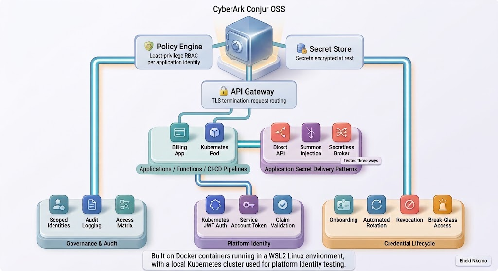

# CyberArk Conjur OSS PAM Lab
 
A hands on lab demonstrating how to deploy CyberArk Conjur OSS, onboard application secrets, configure and manage credential delivery, rotation, revocation, break-glass access, and Kubernetes workload authentication. The lab also implements scoped policy, separation of duties, and the principle of least privilege.
 
Three delivery patterns are used for the same application and database:
 
- Direct API retrieval, where the application authenticates to Conjur, retrieves the secret, and holds it in memory.
- Summon injection, where a launcher process authenticates to Conjur, retrieves the secret, and injects it into the application as an environment variable at startup.
- Secretless Broker, where the broker terminates the application’s database connection, retrieves the database credential from Conjur, and uses it to connect to the database on the application’s behalf. The application never receives or holds the credential.
## What this lab demonstrates
 
| Control outcome | Implementation | Where to look |
|---|---|---|
| Platform deployment and configuration | A CyberArk Conjur OSS environment deployed using CyberArk’s public Conjur Quickstart configuration, including the Conjur server, PostgreSQL backing database, nginx TLS-terminating reverse proxy, Conjur account creation, master data key, administrative user access, and authenticator configuration | `compose/`, Technical Build Record |
| Controlled emergency access | A scoped break-glass identity, audited use, and post-use key rotation | `policies/break-glass-policy.yml`, break-glass procedure in the Governance Documentation |
| Policy and automation | Conjur policy as code, Python and Bash integration with the Conjur REST API, and Kubernetes integration | `apps/`, `scripts/`, `policies/` |
| Scoped onboarding and least privilege | Three application identities provisioned through a five-question scoping gate, with access defined as Conjur policy | `policies/`, onboarding runbook in the Governance Documentation |
| Reduced application exposure to secrets | Direct API retrieval, Summon injection, and Secretless Broker connection patterns | `apps/`, `secretless/` |
| Credential rotation and revocation | Scripted rotation by a scoped identity that can change a password but cannot read it, with revocation tested on the next connection | `scripts/`, `policies/lifecycle/` |
| Workload authentication without a stored API key | A Kubernetes pod authenticates to Conjur using its service-account JWT through the `authn-jwt` authenticator | `policies/k8s-authn-policy.yml`, `k8s/` |
| Operational troubleshooting | Root-cause analysis of rotation, connectivity, TLS, and authentication failures from service and audit logs | Technical Build Record |
| Governance artefacts | Control mappings, secret inventory, access matrix, and onboarding, rotation, key-custody, and break-glass procedures | `docs/` |
 
## Architecture
 
The vault stack consists of six containers: Conjur, PostgreSQL, nginx, the Conjur CLI client, pgAdmin, and a test utility container. A standalone Secretless Broker container and a kind Kubernetes cluster are bridged onto the same Docker network.
 

 
## Secret delivery patterns
 
| Pattern | Who authenticates | Does the application hold the secret? |
|---|---|---|
| Direct API | The application authenticates to Conjur | Yes, in memory |
| Summon | The launcher process authenticates to Conjur | Briefly, as an injected environment variable |
| Secretless Broker | The broker authenticates to Conjur; the application connects to the broker as though it were the database | No. The broker retrieves the credential and uses it to establish the database connection |
 
## Phases
 
1. **Vault deployment**  
   Conjur, PostgreSQL, and nginx deployed with Docker Compose, self-signed TLS, and Conjur CLI authentication.
2. **Policy design**  
   Three application branches scoped through a five-question framework:
   - What is this identity’s function?
   - What systems must it reach, and how does it authenticate to each?
   - For each secret, does the identity need to read, use, or change it?
   - Who owns the identity, and who is responsible for its lifecycle?
   - If the identity is compromised, is the potential impact proportionate to its function?
3. **Application onboarding**  
   Direct API, Summon, and Secretless Broker implementations.
4. **Credential lifecycle**  
   Manual rotation and the drift window it creates, scripted rotation using a scoped rotation identity, revocation, and break-glass access with post-use key rotation.
5. **Kubernetes JWT authentication**  
   A pod authenticates to Conjur using its own service-account token through the `authn-jwt` authenticator. No API key exists in the pod specification, environment, or mounted secret.
6. **Governance documentation**  
   Security controls matrix, onboarding and rotation runbooks, key-custody procedure, break-glass procedure, secret inventory, and access matrix.
Detailed build notes, including the specific errors encountered and how they were diagnosed, are in `/docs`.
 
## References
 
The Kubernetes JWT authentication in Phase 5 follows CyberArk’s published documentation and reference implementation. It is not an independently derived approach.
 
- [JWT-based Kubernetes authentication](https://docs.cyberark.com/conjur-open-source/latest/en/content/integrations/k8s-ocp/k8s-jwt-authn.htm) — CyberArk Conjur OSS documentation. The policy structure used in this lab, including the service ID, authenticator variables, consumer group, and `!permit` grant, follows CyberArk’s published example.
- [cyberark/conjur-authn-k8s-client](https://github.com/cyberark/conjur-authn-k8s-client) — CyberArk’s reference authentication client for the Secrets Manager Kubernetes integration.
CyberArk’s documentation identifies the audience claim as a security consideration. The audience mismatch described in the Technical Build Record is the failure mode that documentation warns about.
 
## Repository structure
 
```text
Conjur-OSS-PAM-Lab/
├── docs/
│   ├── Conjur_Lab_Technical_Build_Record.pdf
│   ├── Conjur_Lab_Governance_Documentation.pdf
│   └── architecture.png
├── compose/          Docker Compose configuration for the vault stack
├── policies/         Conjur policy files: applications, rotation, break-glass, Kubernetes authenticator
│   └── lifecycle/    Revoke and restore policies from Phase 4
├── apps/             Direct API, Summon, and Secretless Broker implementations; Summon secrets.yml
├── secretless/       Secretless Broker configuration
├── scripts/          Rotation script and JWT demonstration
├── k8s/              Test pod specification for Phase 5
└── README.md
```
 
## Stack
 
Docker, Docker Compose, WSL2, CyberArk Conjur OSS, PostgreSQL, nginx, Summon, Secretless Broker, kind, Python (`conjur-api` SDK, `psycopg2`), and Bash.
 
## Scope and limitations
 
This is a local, single-instance lab. It uses self-signed certificates, a manually generated data key, and synthetic credential values.
 
The governance documentation identifies the gaps between this build and a production-grade deployment, including high availability, CA-issued certificates, external KMS/HSM integration, CyberArk CPM, and SIEM integration.
 
## Author
 
Bheki Nkomo — PAM and IAM professional focused on privileged access management, identity governance, cloud security, and security operations.
